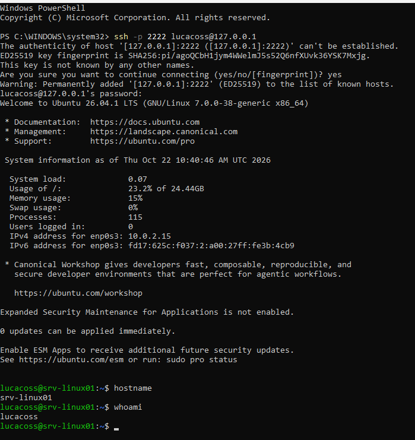
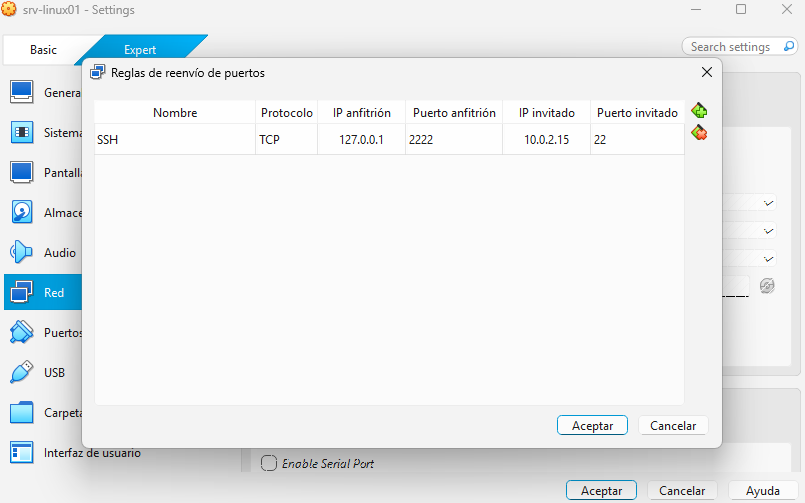

# Acceso remoto por SSH desde Windows a `srv-linux01`

## 1. Objetivo

Aca vamos a documentar la conexión SSH desde Windows (es decir, el equipo anfitrión) hacia la máquina virtual `srv-linux01` en VirtualBox.

### 1.1 Estado del objetivo
La prueba se completó correctamente: desde PowerShell se inició una sesión SSH y los comandos `hostname` y `whoami` devolvieron `srv-linux01` y `lucacoss`.



## 2. Arquitectura de la conexión

``` text
Windows (equipo anfitrión)
    |
    | SSH a 127.0.0.1:2222
    v
VirtualBox: regla NAT TCP 2222 -> 10.0.2.15:22
    |
    v
Ubuntu Server: srv-linux01
    IP invitada observada: 10.0.2.15
    Puerto SSH: 22/TCP
    Usuario remoto: lucacoss
```

`127.0.0.1` es la dirección de loopback de Windows: representa al propio equipo anfitrión. El puerto `2222` es el puerto del lado anfitrión. La regla NAT redirige ese tráfico al puerto `22` de la VM, que es el puerto SSH predeterminado.

> **Importante:** `2222` no es el puerto SSH de Ubuntu; es el puerto utilizado en Windows. El servidor invitado sigue escuchando en el puerto `22`.

## 3. Estado inicial del servidor

### 3.1 Interfaz, IP y rutas

Se utilizaron:

``` bash
ip -br link
ip -br addr
ip route
```

Los resultados mas relevantes fueron:

-   La interfaz `enp0s3` estaba activa.
-   La dirección IPv4 de la VM era `10.0.2.15/24`.
-   La ruta IPv4 predeterminada utilizaba el gateway `10.0.2.2`.
-   La VM pudo comunicarse con `1.1.1.1` mediante `ping`.
-   La resolución de nombres funcionó con `getent hosts ubuntu.com`.

La dirección `10.0.2.15` es la observada durante esta práctica. Como la interfaz usa DHCP, podría cambiar en el futuro; si cambia, habrá que actualizar la regla NAT o planificar una configuración estable.

### 3.2 OpenSSH y activación por socket

Se comprobó la instalación con:

``` bash
dpkg -l openssh-server
```

El paquete `openssh-server` estaba instalado.

Luego se consultó el servicio y el socket:

``` bash
systemctl status ssh --no-pager
systemctl status ssh.socket --no-pager
systemctl is-enabled ssh.socket
systemctl is-enabled ssh
sudo ss -tlnp | grep ':22'
sudo sshd -t
```

Resultados observados:

*   `ssh.service` aparecía como `inactive (dead)` y `disabled`.
*   `ssh.socket` aparecía como `active (listening)` y `enabled`.
*   El puerto TCP 22 estaba en escucha en IPv4 e IPv6 y aparecía asociado a `systemd`.
*   `sshd -t` no mostró errores de sintaxis.

Esto es compatible con la activación por socket de systemd. En esta configuración, `systemd` mantiene el socket escuchando en el puerto 22 y puede activar el servicio SSH cuando llega una conexión. Por eso `ssh.service` puede aparecer inactivo antes de que se reciba una conexión, aunque el socket esté escuchando.

No se habilitó ni deshabilitó ningún servicio adicional durante esta práctica; se utilizó el mecanismo ya configurado.

## 4. Regla de redirección NAT en VirtualBox

Se creó una regla de reenvío de puertos. La ubicación de la opción puede variar según la versión de VirtualBox, pero yo la encontre en **Configuración de la VM → Red → Adaptador 1 → Avanzadas → Reenvío de puertos**.



En modo NAT, la VM puede iniciar conexiones hacia redes externas, pero otros equipos no necesariamente pueden iniciar conexiones directamente hacia ella usando su IP privada de NAT. La regla permite que una conexión al puerto `2222` de Windows se reenvíe al puerto `22` de la VM.

Se usó `127.0.0.1` como IP anfitrión para que la regla escuche solo en el propio Windows, en lugar de exponer ese puerto a otras interfaces del equipo anfitrión.

## 5. Conexión desde PowerShell

Con la VM encendida y la regla configurada, se ejecutó en PowerShell:

``` powershell
ssh -p 2222 lucacoss@127.0.0.1
```

Desglose:

-   `ssh`: inicia el cliente SSH.
-   `-p 2222`: indica el puerto del equipo al que se conecta el cliente.
-   `lucacoss`: usuario con el que se inicia sesión en Ubuntu.
-   `127.0.0.1`: dirección del equipo anfitrión. VirtualBox recibe la conexión en el puerto 2222 y la redirige al invitado.

En una primera conexión, el cliente puede pedir confirmar la huella de la clave de host del servidor. En un entorno profesional, la huella debe verificarse mediante un canal confiable antes de aceptarla.

## 6. Validación

Dentro de la sesión SSH se ejecutaron:

``` bash
hostname
    srv-linux01
whoami
    lucacoss
```

Esto valida que la conexión remota funcionó correctamente.

## 7. Diagnóstico si deja de funcionar

### En Ubuntu Server

``` bash
ip -br addr
ip route
systemctl status ssh.socket --no-pager
systemctl status ssh --no-pager
sudo ss -tlnp | grep ':22'
sudo sshd -t
```

Comprobar que la IP invitada siga coincidiendo con la de la regla NAT.

Si cambió por DHCP, actualizar la regla o planificar una asignación estable.

### En Windows

``` powershell
ssh -vvv -p 2222 lucacoss@127.0.0.1
```

`-vvv` muestra información de diagnóstico detallada. Antes de compartir la salida públicamente, revisarla para evitar publicar información innecesaria del entorno.

Errores frecuentes:

-   **Connection refused:** no hay un servicio/socket aceptando la
    conexión en el destino, o la regla apunta a un puerto incorrecto.
-   **Connection timed out:** puede existir un problema de red, de la
    regla NAT o de filtrado.
-   **Permission denied:** se alcanzó el servidor SSH, pero falló la
    autenticación o la autorización.
-   **Host key verification failed:** la clave guardada no coincide con
    la presentada por el servidor. No borrar la clave guardada sin
    investigar primero el motivo.

## 8. Seguridad y buenas prácticas

-   La regla usa `127.0.0.1` para limitar el acceso al propio Windows.
-   No se modificó el firewall durante esta práctica.
-   No se deshabilitó la autenticación por contraseña ni se modificó
    `sshd_config`.
-   No compartir contraseñas ni claves privadas.
-   En un entorno real, verificar la huella del servidor antes de
    confiar en él y considerar autenticación mediante claves, políticas
    de acceso y controles de firewall apropiados.
-   El puerto `2222` no hace que SSH sea más seguro por sí mismo; aquí
    se usa para definir la redirección local.
