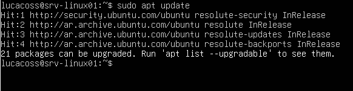
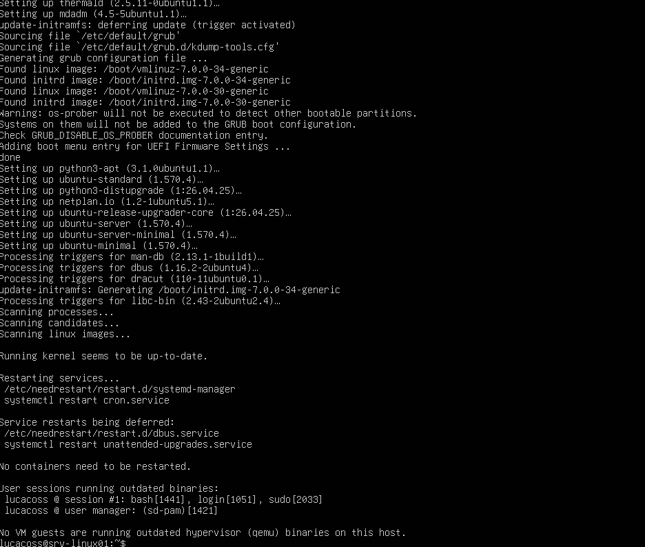
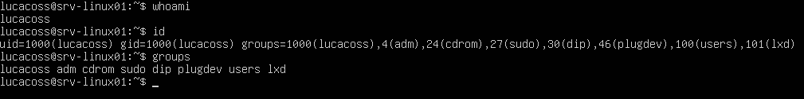
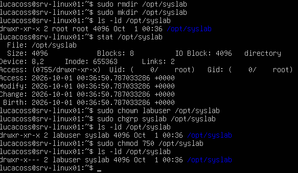
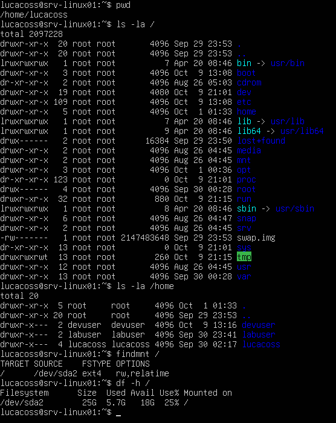

# Administración del sistema

Documentación relacionada con la administración del sistema operativo de `srv-linux01`.

---

## Objetivos

Practicar:

- Usuarios.
- Grupos.
- Permisos.
- Procesos.
- Servicios.
- systemd.
- Logs.
- Paquetes.
- Información del sistema.
- Administración básica.

---

# Administración del sistema

## **1. Actualización del sistema**

Primero vamos a realizar una actualizacion de paquetes y librerias para que todo funcione correctamente. Esto lo podemos realizar con.

Actualización del sistema

``` bash
sudo apt update
```



Y despues:

``` bash
sudo apt upgrade
```



El funcionamiento de estos comandos los detallamos en [docs](../../../docs/README.md)

---

## **2. Usuarios y grupos**

Antes de comenzar a crear y modificar usuarios, se identificó la cuenta utilizada actualmente en `srv-linux01`.

``` bash
whoami
```

``` bash
id
```

Con las respuestas recibidas respectivamente:

``` text
lucacoss
```

``` text
uid=1000(lucacoss) gid=1000(lucacoss) groups=1000(lucacoss),4(adm),24(cdrom),27(sudo),30(dip),46(plugdev),100(users),101(lxd)
```

el comando id es el que nos interesa especialmente porque muestra:

* `UID` → Identificador numérico del usuario.

* `GID` → Grupo principal.

Linux identifica internamente al usuario mediante este número, no solamente mediante lucacoss.

Y el GID corresponda al grupo lucacoss.

* grupos secundarios.

### **2.1 Grupos **

Tambien podemos ver los grupos a los que pertenece nuestro usuario. Mediante el comando.

``` bash
groups
```

Con sus respectivas respuestas: 



Vamos a ver los distintos grupos porque es bastante interesante analizarlos y entenderlos para despues ponernos a crear usuarios.

* `sudo`

El grupo `sudo` permite que sus miembros puedan utilizar `sudo`, sujeto a las reglas configuradas en `/etc/sudoers` y `/etc/sudoers.d/`.

``` bash
sudo whoami
```
respondió con: `root`

* `adm`

El grupo `adm` está relacionado con el acceso a determinados archivos de logs del sistema.

Esto es muy interesante porque despues vamos a estar trabajando con:

``` bash
journalctl
```

* `cdrom`

Permite acceder a dispositivos opticos cuando están configurados de esa manera. No es relevante para nuestro servidor, pero Ubuntu lo incluye en determinados perfiles de usuario.

* `dip`

Está relacionado con determinadas interfaces/configuraciones de red mediante herramientas tradicionales de Linux.

* `plugdev`

Esta relacionado con el acceso a determinados dispositivos extraibles.

* `users`

Grupo general de usuarios.

* `lxd`

### **2.2 Informacion adicional**

Posteriormente, para consultar la información de la cuenta se utilizó:

``` bash
getent passwd lucacoss
```

El resultado fue:

```text
lucacoss:x:1000:1000:Lucas Cossia:/home/lucacoss:/bin/bash
```

La entrada puede interpretarse de la siguiente manera:

usuario : contraseña : UID : GID : comentario : home : shell

Este es particularmente interesante para nosotros porque Ubuntu incluye al usuario en el grupo lxd, que está relacionado con LXD, la tecnologia de gestión de contenedores/máquinas virtuales de Canonical.

Para nosotros:

| Campo             | Valor            |
| ----------------- | ---------------- |
| Usuario           | `lucacoss`       |
| UID               | `1000`           |
| GID               | `1000`           |
| Nombre/comentario | `Lucas Cossia`   |
| Home              | `/home/lucacoss` |
| Shell             | `/bin/bash`      |

### **2.3 `/etc/passwd`**

El archivo `/etc/passwd` contiene información básica sobre las cuentas del sistema.

Sus permisos se verificaron mediante:

``` bash
ls -l /etc/passwd
```

Resultado:

``` text
-rw-r--r-- 1 root root 1750 Sep 30 00:28 /etc/passwd
```

El archivo pertenece al usuario `root` y al grupo `root`.

Los permisos son:

``` text
rw-r--r--
```

Por lo tanto:

`root` puede leer y modificar el archivo.
El grupo `root` puede leerlo.
**Otros usuarios** pueden leerlo.
Los **usuarios normales** no pueden modificarlo directamente.
2.4 `/etc/shadow`

La información relacionada con la autenticación se almacena en `/etc/shadow`.

Sus permisos se verificaron mediante:

``` bash
ls -l /etc/shadow
```

Resultado:

``` text
-rw-r----- 1 root shadow 846 Sep 30 00:28 /etc/shadow
```

`root` puede leer y modificar el archivo.
Los miembros del grupo `shadow` pueden leerlo.
Los demás usuarios no tienen permisos sobre el archivo.

Esta diferencia de permisos es importante porque `/etc/shadow` contiene
información sensible relacionada con la autenticación de los usuarios.

### **2.4 Directorio personal**

La cuenta lucacoss tiene como directorio personal:

`/home/lucacoss`

Se verificó mediante:

``` bash
ls -ld /home/lucacoss
```

Resultado:

``` text
drwx------ 4 lucacoss lucacoss 4096 Sep 30 02:17 /home/lucacoss
```

El directorio pertenece al usuario lucacoss y al grupo `lucacoss`.

Los permisos drwx------ indican que el propietario tiene permisos sobre el
directorio, mientras que el grupo y otros usuarios no tienen permisos.

Durante la verificación también se ejecutó accidentalmente:

``` bash
ls -ld lucacoss
```

que produjo:

``` text
ls: cannot access 'lucacoss': No such file or directory
```

Esto ocurrió porque lucacoss fue interpretado como una ruta relativa desde
el directorio actual.

La ruta correcta del directorio personal es:

``` text
/home/lucacoss
```

Este caso permitió comprobar en la práctica la diferencia entre una ruta
relativa y una ruta absoluta.

### **2.5 Creacion de un usuario**

Vamos a crear un usuario llamado: `labuser`.

Para eso ejecutamos el comando.

``` bash
sudo useradd -m -s /bin/bash labuser
```

El comando useradd permite crear la cuenta del usuario. En este caso utilizamos algunas opciones para configurar desde el principio el directorio personal y el shell de inicio de sesión. En particular, queremos que nuestro usuario de laboratorio tambien tenga su propio `/home` y un shell definido.

Por eso utilizamos los parametros.

* `-m` → crea el directorio /home/labuser.
* `-s /bin/bash` → establece Bash como shell de inicio de sesión.
* `labuser` → nombre de la cuenta.

Otra cosa que ocurre es que una cuenta recién creada no tiene necesariamente una clave utilizable para iniciar sesión. Por ende vamos a establecerla:

``` bash
sudo passwd labuser
```

Con esto, el sistema va a pedir dos veces la clave, para establecerla correctamente. 

### **2.6 Validacion de la creacion del usuario**

Ahora vamos a proceder a validar que todo se haya creado correctamente

``` bash
id labuser
```

Y la salida es: 

``` text 
uid=1001(labuser) gid=1001(labuser) groups=1001(labuser)
```

> El UID puede variar por el sistema. Puede ocurrir que no sea 1001.

Y tambien:

``` bash
getent passwd labuser
```

Con su respectiva salida:

``` text 
labuser:x:1001:1001::/home/labuser:/bin/bash
```

Despues verificamos el directorio `/home`:

``` bash 
ls -ld /home/labuser
```

Y su salida fue:

``` text 
drwxr-x--- 2 labuser labuser 2096 Sep 30 22:46 /home/labuser
```

Y finalmente su shell asociado:

``` bash
getent passwd labuser
```

``` text 
/bin/bash
```

Por ende todo se realizo correctamente. 

### **2.7 Creacion de grupos secundarios**

Creemos un grupo específico para nuestro laboratorio:

``` bash
sudo groupadd syslab
```

Y ahora agregamos `labuser` al grupo:

``` bash
sudo usermod -aG syslab labuser
```

* `-a`

    append: agrega el grupo sin eliminar los grupos secundarios existentes.

* `-G`

    Indica los grupos secundarios.

> No utilizamos solo `-G`. Pues, establece la lista de grupos secundarios indicada. Si el usuario ya perteneciera a otros grupos secundarios, podríamos reemplazar esa lista accidentalmente.

Ahora verificamos los cambios

``` bash
id labuser
```

``` bash
groups labuser
```

Con sus salidas:

``` text
uid=1001(labuser) gid=1001(labuser) groups=1001(labuser),1002(syslab)
labuser : labuser syslab
```

### **2.8 Diferencia entre usuarios**

Algo que podemos mostrar es la diferencia que hay entre los usuarios `lucacoss` y `labuser`. Si nosotros entramos temporalmente a labuser con 

``` bash
su - labuser
```

Y ejecutamos:

``` bash
sudo whoami
```

``` text
sudo: I´m sorry labuser. I´m afraid I can´t do that
```

Despues salimos con `exit`.

Como `labuser` no esta en el grupo `sudo` no tiente aquellos permisos.

### **2.9 Modificacion del usuario**

Aca podemos realizar modificaciones como:

``` bash
sudo usermod -c "Usuario de laboratorio" labuser
```

* El parametro `-c` modifica el campo de comentario o información descriptiva de la cuenta.

Y despues lo vereficamos

``` bash
getent passwd labuser
``` 

``` text
labuser:x:1001:1001:Usuario de laboratorio:/home/labuser:/bin/bash
```

Hay mas parametros que podemos utilizar como:

* `-s` → Establece o modifica el shell de inicio de sesión de la cuenta.

Tambien podemos modificar su clave con `sudo passwd labuser` o bloquear la cuenta con:

``` bash
sudo passwd -l labuser
```

Consultar su estado:

``` bash
sudo passwd -S labuser
```

O desbloquear su clave:

``` bash
sudo passwd -u labuser
```

De esta manera podemos deshabilitar temporalmente la autenticación mediante la clave de una cuenta sin eliminarla, lo que puede utilizarse como una forma de baja lógica.

---

## **3. Permisos, propietarios y grupos**

En Linux, cada archivo y directorio tiene principalmente:
* un propietario;
* un grupo propietario;
* permisos para el propietario;
* permisos para el grupo;
* permisos para otros usuarios.´

Vamos a trabajar con labuser y el grupo syslab que ya creamos.

Primero vamos a crear un directorio destinado a nuestras pruebas:

``` bash
sudo mkdir /opt/syslab
```

El motivo es que `/opt` es un lugar apropiado para software o recursos adicionales del sistema. En nuestro caso lo utilizaremos simplemente como un recurso de laboratorio. Ahora verificamos cómo quedó:

``` bash
ls -ld /opt/syslab
    drwxr-xr-x 2 root root 4096 Oct 1 00:09
```

Aca podemos hacer un analisis basico de permisos:

* Primero. Un analisis completo de la sintaxis

* `d`           → directorio
* `rwx`         → permisos del propietario
* `r-x`         → permisos del grupo
* `r-x`         → permisos de otros
* `2`           → cantidad de enlaces
* `root`        → propietario
* `root`        → grupo propietario
* `4096`        → tamaño
* `Oct 1 00:09` → fecha de modificación
* `/opt/syslab` → ruta

* Segundo. Tenemos 3 grupos de 3 tipos de permisos

    rwx - Propietario

    r-x - Grupo

    r-x - Otros

| Permiso | Significado |
|---|---|
| `r` | read — lectura |
| `w` | write — escritura |
| `x` | execute — ejecución |

### **3.1 Cambiar propietarios**

El comando `chown` significa **Change owner**

``` bash
sudo chown labuser /opt/syslab
```

Y lo verificamos 

``` bash
ls -ld /opt/syslab
    drwxr-xr-x 2 labuser root 4096 Oct 1 00:09
```

Y despues esta el comando `chgrp` que significa **Change group**

``` bash
sudo chgrp syslab /opt/syslab
```

Y lo verificamos 

``` bash
ls -ld /opt/syslab  
    drwxr-xr-x 2 labuser syslab 4096 Oct 1 00:09
```

También podríamos haber realizado ambas operaciones mediante `chown`:

``` bash
sudo chown labuser:syslab /opt/syslab
```

### **3.2 Modificacion de permisos**

En esta seccion vamos a usar `chmod`

Primero vamos a explicar otras cosas de los permisos.

* `r = 4`
* `w = 2`
* `x = 1`

Por ende, tenemos que sacar cuentas como:

7 = 4 + 2 + 1 = rwx

5 = 4 + 0 + 1 = r-x

0 = 0 + 0 + 0 = ---

| Valor | Permisos |
|---:|---|
| `7` | `rwx` |
| `6` | `rw-` |
| `5` | `r-x` |
| `4` | `r--` |
| `3` | `-wx` |
| `2` | `-w-` |
| `1` | `--x` |
| `0` | `---` |

| Usuario | Permisos |
|---|---|
| `labuser` | `rwx` |
| grupo `syslab` | `r-x` |
| otros | `---` |

Entonces si realizamos una practica como:

1. Crear el directorio

2. Verificarlo

3. Ver información detallada

4. Cambiar propietario

5. Cambiar grupo

6. Verificar

7. Aplicar permisos

8. Verificamos nuevamente



### **3.3 Interaccion entre usuarios, grupos y permisos**

Vamos a empezar con unos comandos

``` bash
su - labuser
whoami
    labuser
cd /opt/syslab
pwd
    /opt/syslab
touch prueba.txt
ls -l
    total 0
    -rw-rw-r-- 1 labuser labuser 0 Oct 1 00:50 prueba.txt
```

Aca detectamos una situacion interesante. Aunque el directorio `/opt/syslab` tiene como grupo propietario a `syslab`, el archivo nuevo quedó con el grupo `labuser`.

Esto ocurre porque un directorio no hereda automáticamente su grupo propietario a los archivos nuevos que se crean dentro de él.
Por defecto, el nuevo archivo utiliza el grupo principal del usuario que lo crea.

Si ejecutamos:

``` bash
umask
```

Vamos a recibir:

``` text
0002
```

La `umask` determina qué permisos se eliminan de los permisos iniciales al crear archivos y directorios. En nuestro caso, el valor `0002` contribuyó a que el archivo se creara con permisos `664` (rw-rw-r--).
El grupo propietario del archivo es un aspecto diferente y, en este caso, corresponde al grupo principal de labuser.

Y esto nos lleva a una herramienta muy interesante de Linux: `setgid`. En un directorio, setgid hace que los nuevos archivos y subdirectorios creados dentro de él hereden el grupo propietario del directorio.

Primero vamos a salir con `exit`. Despues comprobamos...

``` bash
ls -ld /opt/syslab
    drwxr-x--- 2 labuser syslab 4096 Oct 1 00:50 /opt/syslab
ls -l /opt/syslab
    total0
    -rw-rw-r-- 1 labuser labuser 0 Oct 1 00:50 preuba.txt
```

Esta situacion se puede solucionar con `setgid`.

Actualmente tenemos:
| Ubicacion | dueño:grupo |
|---|---|
| `Directorio` | `labuser:syslab` |
| `Archivo` | `labuser:labuser` |

Pero, por ejemplo, si `syslab` representa un **equipo de trabajo**. Queremos que los archivos creados dentro de `/opt/syslab` pertenezcan automáticamente al grupo: `syslab`

Para eso podemos utilizar `setgid` en el directorio.

``` bash
sudo chmod g+s /opt/syslab
```

> El g+s significa que estamos activando el bit setgid para el grupo del directorio.

Y lo comprobamos:

``` bash
ls -ld /opt/syslab
    drwxr-s--- 2 labuser syslab 4096 Oct 1 00:50 /opt/syslab
```

Antes en los permisos de grupo teniamos `r-x`. Pero ahora tenemos `r-s`. Esa `"s"` significa que `setgid` esta *activo*.

Ahora vamos a crear otro archivo:

``` bash
su - labuser
whoami
    labuser
touch /opt/syslab/prueba-setgid.txt
ls -l /opt/syslab
    total 0
    -rw-rw-r-- labuser syslab 0 Oct 1 01:17 prueba-setgit.txt
    -rw-rw-r-- labuser labuser 0 Oct 1 00:50 prueba.txt
```

Hasta ahora `labuser` es el propietario del directorio: `labuser:syslab`

y tiene: `rwx`

Mientras que el grupo syslab tiene: `r-x`

El problema es que todavía no tenemos otro usuario utilizando ese grupo. Así que vamos a crear un segundo usuario de laboratorio `:)`.

### **3.4 Permisos**

### **3.4.1 Habilitar escritura para el grupo**

Hasta este punto, el directorio `/opt/syslab` tenía el bit `setgid` activado, pero el grupo `syslab` no disponía de permiso de escritura sobre el directorio.

Por eso, aunque `devuser` pertenecía a `syslab`, no podía crear nuevos archivos dentro de él.

Para permitir que los integrantes del grupo creen archivos, modificamos los permisos del directorio:

```bash
sudo chmod g+w /opt/syslab
```

El parámetro `g+w` agrega el permiso de escritura (`w`) al grupo propietario, sin modificar los demás permisos.

Al intentar listar el contenido desde `lucacoss`, recibimos un error de permisos. Esto ocurre porque el directorio no concede acceso a usuarios externos a su propietario y grupo. Para consultar su contenido como administrador, utilizamos:

```bash
sudo ls -l /opt/syslab
```

Con esto comprobamos que `devuser` pudo crear el archivo `archivo-devuser.txt`, que quedó asociado al grupo `syslab`.

### **3.4.2 Verificación de los permisos del archivo**

Al revisar el archivo mediante `ls -l`, obtuvimos:

```text
-rw-r--r-- 1 devuser syslab 0 Oct 9 13:20 archivo-devuser.txt
```

Podemos interpretar sus permisos de la siguiente manera:

| Categoría | Permisos | Significado |
|---|---|---|
| Propietario (`devuser`) | `rw-` | Puede leer y modificar el archivo |
| Grupo (`syslab`) | `r--` | Puede leer, pero no modificar |
| Otros | `r--` | Pueden leer, pero no modificar |

Aunque el archivo pertenece al grupo `syslab`, sus integrantes no tienen permiso de escritura. Esto explica por qué `labuser` no podía modificarlo.

**La pertenencia a un grupo no concede permisos automáticamente:** el recurso debe otorgar los permisos necesarios a ese grupo.

### **3.4.3 Modificar los permisos del archivo**

Para permitir que los integrantes de `syslab` modifiquen el archivo, ejecutamos como `lucacoss`:

```bash
sudo chmod g+w /opt/syslab/archivo-devuser.txt
```

Este comando agrega el permiso de escritura al grupo propietario del archivo.

De esta manera, los permisos pasan de:

```text
rw-r--r--
```

a:

```text
rw-rw-r--
```

En formato octal, el cambio es de `644` a `664`.

Ahora el propietario `devuser` y los integrantes del grupo `syslab` tienen permisos de lectura y escritura.

### **3.4.4 Comprobar la colaboración entre usuarios**

Volvemos a ingresar como `labuser`:

```bash
su - labuser
```

Y ejecutamos:

```bash
echo "Modificacion realizada por labuser" >> /opt/syslab/archivo-devuser.txt
```

La operación se realizó correctamente. Esto demuestra que `labuser` puede modificar un archivo creado por `devuser` cuando ambos pertenecen al grupo propietario y el archivo concede escritura al grupo.

El operador `>>` agrega texto al final del archivo sin reemplazar su contenido existente (A diferencia de `>`).

### **Conclusión de la práctica**

Durante esta práctica comprobamos que la colaboración entre usuarios en Linux depende de varios elementos:

- **Propietario y grupo propietario:** determinan qué categoría de permisos se aplica al usuario.
- **Permisos del directorio:** controlan si un usuario puede acceder al directorio y crear o eliminar entradas.
- **`setgid`:** permite que los archivos y subdirectorios nuevos hereden el grupo propietario del directorio.
- **`chmod`:** permite modificar los permisos de archivos y directorios.
- **Permisos del archivo:** determinan si un usuario puede leerlo o modificarlo una vez que tiene acceso a él.

También observamos que `setgid` no garantiza que los archivos nuevos tengan escritura grupal. Para configurar correctamente un directorio compartido, debemos considerar cómo se crean los archivos y qué permisos reciben inicialmente.

### **3.5 Umask y su configuracion**

Antes de empezar esta seccion, nos es conveniente juntar los valores de los umask, esto lo hacemos con el comando antes mostrado, realizando esto con los tres usuarios, empezando desde el usuario principal, osea:

``` bash
whoami
    lucacoss
umask
    0002
su - labuser
umask
    0002
su - devuser
umask
    0002
```

Bueno, ahora si, vamos a estudiar cómo se relaciona la `umask` con nuestro directorio compartido `/opt/syslab`.

### **3.5.1 ¿Qué significa umask 0002?**

La `umask` determina qué permisos se excluyen de los permisos iniciales solicitados al crear archivos y directorios.

El valor se expresa en octal. El último dígito, 2, excluye el permiso de escritura para otros usuarios.

Podemos observar su efecto con estos ejemplos:

| Tipo de recurso | Permisos | iniciales | Con umask 0002 | Resultado |
|---|---|---|---|---|
| Archivo regular |	666      | 0002      |	664 | `rw-rw-r--` |
| Directorio      |	777      | 0002      |	775 | `rwxrwxr-x` |

Estos son los resultados habituales para archivos regulares y directorios cuando los programas solicitan esos permisos iniciales. La `umask` no agrega permisos que el programa no haya solicitado.

#### **3.5.1 Creación de un archivo**

Ahora ingresamos como `devuser` y csudoreamos un archivo dentro del directorio compartido:

```bash
touch /opt/syslab/prueba-umask.txt
```

Y verificamos sus permisos:

```bash
ls -l /opt/syslab/prueba-umask.txt
    -rw-rw-r-- 1 devuser syslab 0 Oct 9 14:33 /opt/syslab/prueba-umask.txt
```

El archivo tiene permisos `664`. Tanto el propietario como el grupo pueden leer y modificar el contenido, mientras que otros usuarios solo pueden leerlo.

Además, el archivo pertenece al grupo `syslab`. Esto ocurre porque el directorio padre tiene activado el bit `setgid`.

#### **3.5.2 Creación de un subdirectorio**

Ahora creamos un subdirectorio:

```bash
mkdir /opt/syslab/directorio-umask
```

Verificamos sus permisos y grupo:

```bash
ls -ld /opt/syslab/directorio-umask
    drwxrwsr-x 2 devuser syslab 4096 Oct 9 14:34 /opt/syslab/directorio-umask
```

El subdirectorio tiene permisos `2775`: el propietario y el grupo disponen de permisos completos, mientras que otros usuarios pueden leer y atravesar el directorio.

La `s` en los permisos del grupo indica que el bit `setgid` también está activo en el subdirectorio. Este comportamiento permite mantener la herencia del grupo en los niveles siguientes del directorio compartido.

En esta práctica comprobamos que `umask` y `setgid` cumplen funciones diferentes y complementarias:

- `umask` influye en los permisos iniciales de archivos y directorios.
- `setgid` permite heredar el grupo propietario del directorio padre.
- Los permisos resultantes determinan qué operaciones pueden realizar los distintos usuarios.

La combinación de ambos mecanismos permite preparar directorios compartidos de manera más consistente, aunque todavía debemos comprobar cómo se comportan las modificaciones de archivos y los comandos ejecutados mediante `sudo`.

### **3.6 Prueba de colaboración entre usuarios**

Una vez configurado el directorio compartido `/opt/syslab`, se realizó una prueba para verificar que los usuarios `devuser` y `labuser` pudieran trabajar sobre un mismo archivo.

**Procedimiento**

Primero, se inició una sesión con `devuser` y se creó un archivo con contenido inicial:

```bash
su - devuser
echo "Creado por devuser" > /opt/syslab/prueba-colaboracion.txt
ls -l /opt/syslab/prueba-colaboracion.txt
```

Luego, se cambió a `labuser` y se agregó contenido al mismo archivo:

```bash
exit
su - labuser
echo "Modificado por labuser" >> /opt/syslab/prueba-colaboracion.txt
cat /opt/syslab/prueba-colaboracion.txt
```

Se verificó que ambos usuarios pudieron escribir sobre el mismo archivo y que el contenido agregado por cada uno se conservó.

**Análisis técnico**

El funcionamiento se debe a la combinación de varios mecanismos:

- El directorio `/opt/syslab` permite la escritura a los miembros del grupo `syslab`.
- El bit `setgid` hace que los archivos nuevos hereden el grupo `syslab`.
- La máscara `umask 0002`, en las sesiones utilizadas, permite que los archivos creados con permisos iniciales habituales tengan escritura para el grupo.
- Los permisos del archivo permiten que el segundo usuario agregue contenido sin ser su propietario.

**Conclusión**

La prueba demuestra cómo configurar un espacio de trabajo compartido en Linux para que distintos usuarios colaboren sobre los mismos archivos sin necesidad de utilizar la cuenta `root` para cada operación.

---

## **4. Sistema de archivos**

### **4.1 Introduccion**
En Linux, todo parte de un directorio raíz representado por /. No debe confundirse con /root, que es el directorio personal del usuario administrador.

Esta es una primera referencia de los directorios que conviene conocer:

| Directorio |	Función principal |
|---|---|
| `/`    | Raíz de toda la jerarquía de directorios. |
| `/home`| Directorios personales de los usuarios comunes. |
| `/root`| Directorio personal de root. |
| `/etc` | Archivos de configuración del sistema y de servicios. |
| `/var` | Datos variables: registros, cachés, colas y otros datos de servicios. |
| `/usr` | Gran parte de los programas, bibliotecas y recursos instalados. |
| `/opt` | Software adicional y aplicaciones instaladas fuera de la distribución habitual. |
| `/tmp` | Archivos temporales; su limpieza depende de la configuración del sistema. |
| `/dev` | Archivos de dispositivo que representan interfaces con dispositivos y recursos del sistema. |
| `/proc`| Sistema de archivos virtual que expone información de procesos y del kernel. |
| `/sys` | Información e interfaces del kernel relacionadas con dispositivos y otros objetos del sistema. |
| `/mnt` | Punto de montaje convencional para montajes temporales o administrativos. |
| `/media`| Punto de montaje convencional para medios extraíbles. |
| `/boot`| Archivos necesarios para el arranque, como kernels e imágenes de inicio. |

> Estas funciones son las habituales; los contenidos concretos pueden variar según la distribución y los servicios instalados.

Vamos a ejercutar unos comandos sencillos para saber como orientarnos mejor

``` bash
pwd
ls -la /
ls -la /home
findmnt /
df -h /
```

* `pwd` indica en qué directorio estás ubicado.

* `ls -la /` muestra el contenido de la raíz, incluidos los elementos ocultos.

* `findmnt /` permite identificar qué sistema de archivos está montado en `/`.

``` text
TARGET SOURCE     FSTYPE OPTIONS
/      /dev/sda2  ext4   rw,relatime
```

> `/dev/sda2` es una partición del disco virtual que utiliza tu máquina virtual. No es un directorio, sino un dispositivo de bloques que contiene el sistema de archivos.

* `df -h /` muestra el espacio total, utilizado y disponible del sistema de archivos que contiene la raíz.

``` text
Filesystem   Size  Used  Avail  Use%  Mounted on
/dev/sda2     25G   5.7G   18G    25%  /
```



## **4.2 Rutas Relativas/Absolutas**

Antes de estudiar todos los directorios, vamos a dominar cómo movernos entre ellos. Esto también se relaciona con lo que te ocurrió anteriormente al intentar consultar una ruta relativa cuando querías acceder a `/home/lucacoss`.
Una ruta absoluta comienza desde `/`. Una ruta relativa se interpreta desde tu directorio actual.

Por ejemplo, si nos posicionamos en `/home/lucacoss`:

| Comando o ruta |	Significado |
|---|---|
| `/etc` | Ruta absoluta al directorio de configuración. |
| Documents | Directorio Documents dentro de tu ubicación actual, si existe. |
| `..` | Directorio padre. |
| `.`  | Directorio actual. |
| `~`  | Directorio personal del usuario actual en una shell habitual. |

Despues hay comandos interesantes como `realpath` que permite obtener una ruta absoluta para una ruta existente, resolviendo componentes como `.` y `..`.

### **4.2 Jerarquia de directorios**

En Linux, todos los archivos y directorios se organizan a partir de la raíz `/`. No existen letras de unidad como C: o D: al estilo de Windows. Otros discos y particiones se incorporan a la jerarquía mediante puntos de montaje.

## Directorios fundamentales

### `/etc` — Configuración del sistema
Contiene archivos de configuración del sistema operativo y de los servicios instalados. Generalmente son archivos de texto que definen cómo deben comportarse los distintos componentes.

Ejemplos importantes:

| Ruta | Función |
|---|---|
|`/etc/passwd	`| Información básica de las cuentas de usuario. |
|`/etc/shadow	`| Información protegida relacionada con las contraseñas. |
|`/etc/group	`| Información de los grupos locales. |
|`/etc/hostname	`| Nombre del equipo. |
|`/etc/hosts	`| Asociaciones locales entre nombres y direcciones IP. |
|`/etc/fstab	`| Configuración de sistemas de archivos que pueden montarse automáticamente. |
|`/etc/ssh/sshd_config` | Configuración del servidor SSH, si está instalado. |
|`/etc/systemd/`	| Configuración de diversos componentes de systemd. |

Ejemplo práctico: si necesitás revisar la configuración del servidor SSH, buscarías sus archivos en `/etc/ssh/`.

``` bash
ls -ld /etc/ssh/
```

### `/var` — Datos variables

El directorio `/var` almacena información que cambia durante el funcionamiento del sistema. Es especialmente importante en servidores porque ahí suelen crecer los registros, las cachés y los datos de aplicaciones.

|Ruta |	Función |
|---|---|
| `/var/log/` |	Registros del sistema y de las aplicaciones. |
| `/var/cache/` |	Datos de caché que pueden regenerarse. |
| `/var/lib/` |	Estado persistente de aplicaciones y servicios. |
| `/var/spool/` |	Datos pendientes de procesamiento, como colas de trabajos. |
| `/var/tmp/` |	Archivos temporales que, según las convenciones del sistema, pueden conservarse más tiempo que los de /tmp. |
| `/var/log/journal/` |	Ubicación posible de registros persistentes de systemd-journald. |

Ejemplos de administración:
- Si el disco se llena, revisar `/var/log` puede ayudar a detectar registros que crecieron demasiado.
- Si una aplicación pierde su estado al reiniciarse, conviene conocer qué guarda en `/var/lib`.
- Si usás `apt`, sus cachés y datos de paquetes pueden ocupar espacio bajo `/var`.

``` bash
ls -ld /var/log /var/cache /var/lib
```

### `/usr` — Programas, bibliotecas y recursos

`/usr` contiene gran parte de los programas, bibliotecas y recursos instalados en el sistema. 

| Ruta | Función |
|---|---|
| `/usr/bin/  `| Gran parte de los comandos y programas de usuario. |
| `/usr/sbin/ `| Herramientas administrativas; la separación respecto de /usr/bin depende de la distribución. |
| `/usr/lib/`  | Bibliotecas y componentes de software. |
| `/usr/share/`| Datos compartidos independientes de la arquitectura, como documentación. |
| `/usr/local/`| Software instalado localmente por el administrador, fuera de la gestión habitual de paquetes de la distribución. |

Por ejemplo, el comando `ls` suele encontrarse en `/usr/bin/ls`.

``` bash
command -v ls
ls -ld /usr/bin /usr/lib /usr/share /usr/local
```

### `/opt` — Software adicional

`/opt` se utiliza convencionalmente para paquetes de software adicionales. Es una ubicación apropiada para determinadas aplicaciones que mantienen sus propios directorios de instalación.

``` bash
ls -ld /opt
ls -ld /opt/syslab
```

### `/home` y `/root` — Directorios personales

`/home` contiene habitualmente los directorios personales de los usuarios comunes. Cada usuario puede almacenar ahí sus documentos, configuraciones personales y otros archivos. En este servidor:

``` text
/home/lucacoss
/home/labuser
/home/devuser
```

`/root`, en cambio, es el directorio personal de la cuenta de administración root. No es la raíz del sistema: esa es /.

Podés comprobar las rutas existentes con:

``` bash
ls -ld /home /home/lucacoss /root
```

La consulta de `/root` puede mostrar permisos restrictivos, lo cual es normal.

### `/tmp` y `/var/tmp` — Archivos temporales

Ambos directorios permiten guardar información temporal, pero existe una diferencia convencional:

- `/tmp` se utiliza para archivos temporales que pueden eliminarse durante el arranque o por tareas de limpieza.
- `/var/tmp` se destina a archivos temporales que, en general, deben poder persistir durante más tiempo.

La política exacta depende de la distribución y su configuración. No asumas que todo lo que está en /tmp desaparece inmediatamente al reiniciar.
Podés inspeccionar sus permisos con:

``` bash
ls -ld /tmp /var/tmp
```

Es habitual encontrar permisos como `drwxrwxrwt` en estos directorios. La `t` final indica el sticky bit, que restringe quién puede eliminar o renombrar entradas en un directorio compartido.
Ese es uno de los usos prácticos de los permisos especiales que vimos anteriormente.

### `/dev` — Dispositivos

Linux representa muchos dispositivos mediante archivos especiales bajo `/dev`. No son archivos ordinarios que contengan datos de la manera habitual.
Ejemplos comunes:

- /dev/sda: un dispositivo de bloques, como un disco.
- /dev/sda2: una partición de ese disco.
- /dev/null: descarta los datos escritos en él.
- /dev/zero: proporciona bytes nulos al leerlo.
- /dev/tty: representa el terminal asociado al proceso, cuando corresponde.

En este servidor, vemos `/dev/sda2` en la salida de findmnt `/`. Esa partición contiene el sistema de archivos raíz.
Para comprobar algunos dispositivos:

```bash
ls -l /dev/null /dev/zero
ls -l /dev/sda /dev/sda2
```

Los últimos elementos pueden variar según la configuración y los dispositivos que exponga la máquina virtual.

### `/boot` — Archivos de arranque

Contiene archivos necesarios para iniciar el sistema, como kernels e imágenes de inicio. Para inspeccionarlo:

``` bash
ls -lh /boot
```

Su contenido depende de la distribución, el kernel instalado y la configuración del arranque. No conviene borrar manualmente archivos de este directorio: una limpieza incorrecta puede dejar el sistema sin poder arrancar.

### `/mnt` y `/media` — Puntos de montaje

Son ubicaciones convencionales para montar sistemas de archivos:

- /mnt: suele utilizarse para montajes temporales o administrativos.
- /media: suele utilizarse para medios extraíbles.

Un punto de montaje es un directorio donde se hace accesible el contenido de otro sistema de archivos. El contenido que había debajo del directorio antes del montaje queda oculto mientras el montaje está activo. Para consultar los montajes actuales:

``` bash
findmnt
```

## Practica sobre directorios fundamentales

1. Identificar el hostname 

``` bash
cat /etc/hostnmae
```

2. Examinar el espacio de los logs

``` bash
sudo du -sh /var/logs
```

3. Localizar el comando `ls`

``` bash
command -v ls
```

4. Consultar los permisos de `/tmp`

```bash
ls -ld /tmp
```

5. Ver las interfaces de red

``` bash
ls /sys/class/net
```

6. Examinar los puntos de montaje

```bash
finmnt
```

## 5. Procesos

## 6. Servicios y systemd

## 7. Logs y journalctl

## 8. Gestión de paquetes

## 9. Información y diagnóstico del sistema

## 10. Tareas de administración

## 11. Problemas encontrados y soluciones